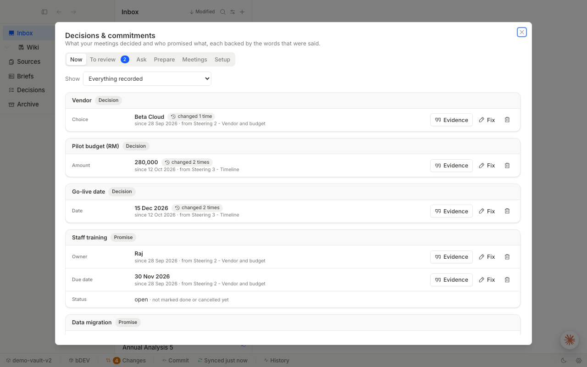
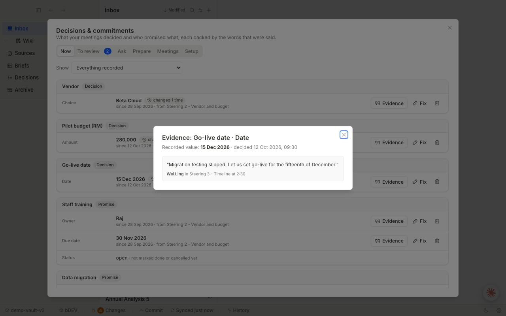

# Memoria

Memoria is a local-first desktop app that turns meetings into a memory your team can check. It records or imports a meeting, transcribes it on your computer, and keeps a ledger of the decisions made and the commitments given, such as "go-live is 15 December" or "Raj will run the staff training by 30 November". Every value in the ledger, and every answer to a question, comes with the exact quote, speaker and meeting it was taken from, and earlier values stay in the history instead of being overwritten.





Memoria is a final-year project (Universiti Malaya). The desktop shell is a modified fork of [Tolaria](https://github.com/refactoringhq/tolaria); the decision and commitment engine is separate Python code (`../engine`). See [NOTICE.md](NOTICE.md).

## What you can do

- **Record or import a meeting.** Live transcription with speaker separation, or import a file, web page or YouTube link.
- **Decisions & commitments** (one panel, six tabs): *Now* (current values, evidence, history, fix or remove), *To review* (changes the AI is unsure about wait for you), *Ask* (plain-English questions, always with evidence), *Prepare* (open commitments and recent changes for the next meeting, copy or save as a note), *Meetings*, *Setup* (what to track).
- **Notes stay plain markdown files** with YAML frontmatter in a git-backed folder (the vault).

## Install and run

Requirements: Apple-silicon Mac (developed and tested on macOS 26), git, Python 3.11 (`brew install python@3.11`), about 5 GB of free disk for models (downloaded once on first use, so it needs internet once).

```bash
pnpm install
python3.11 -m pip install -r src-tauri/resources/python/requirements.txt
scripts/memoria-doctor.sh      # read-only checklist: prints READY or NOT READY with the fix
pnpm tauri dev                 # run the desktop app
```

Browser-only preview with built-in sample data (no Tauri, no Python, no models): `npx vite --port 5199`, then open http://localhost:5199.

Release build and installing on another Mac: see [docs/DEPLOYMENT.md](docs/DEPLOYMENT.md).

The first time you open the app, choose **Getting Started**. It creates a small vault from files bundled in the app (no internet needed) with a welcome note and three fictional meetings you can use to try the whole flow.

## Environment variables

| Variable | Default | Purpose |
|---|---|---|
| `MEMORIA_PYTHON` | `/opt/homebrew/bin/python3.11` | Python 3.11 used for transcription, import and the decision engine |
| `MEMORIA_ENGINE_DIR` | engine bundled in the app, else `../engine` | Folder that contains `memoria_engine/` |
| `MEMORIA_LEDGER_EXTRACTOR` | `mlx` | `mlx` (local language model), `keyword` (simple rules, no model) or `none` (no extraction). Use `keyword` or `none` to try the app without loading a model |
| `MEMORIA_GETTING_STARTED_REPO_URL` | unset | Clone this git repository instead of the bundled starter vault |

Apps started from Finder do not see shell variables. Set them for a Finder launch with `launchctl setenv NAME value`, or start the app from a terminal with `open -a Memoria` after exporting them.

## Tests

```bash
npx vitest run                  # frontend (React) tests
npx tsc -b                      # type check
npx eslint . --max-warnings=0   # lint
cd src-tauri && cargo test --locked   # Rust tests (about 1,000; heavy, run with: nice -n 19)
```

Most Rust tests are inherited from Tolaria. Memoria's own tests cover the engine bridge (`ledger`), the starter vault (`demo_starter`, `getting_started`), resource lookup (`bundled_resources`), voice profiles (`voice_profiles`), and the frontend files in `src/components/ledger/`, `src/lib/ledgerApi`, `src/lib/transcriptNote` and the voice-consent setting.

## Privacy

- Transcription, extraction and questions run on your computer. Meeting audio, transcripts and the ledger are never uploaded.
- The ledger lives in the app data folder, outside your notes; transcripts are notes in your vault.
- Recognising people by voice is **off by default**. When you turn it on (in Settings, or via the one-time question after you name speakers), voice profiles are saved only on this computer, and **Delete all saved voice profiles** in Settings removes them.
- Crash reporting and usage analytics are off unless you switch them on, and no keys for them are configured in this repository (`.env.example` is empty).
- Links and update checks that pointed at the upstream project are switched off (`SHOW_UPSTREAM_LINKS` in `src/constants/feedback.ts`).
- Models are downloaded once from Hugging Face on first use; nothing else needs the internet.

## Status and limitations

Prototype for evaluation, version 0.1.0.

- Apple-silicon macOS only. Windows and Linux are not supported for transcription or the ledger.
- Needs Python 3.11 and its packages installed on the machine; they are not bundled. The first run downloads about 5 GB of models.
- The release is ad-hoc signed, not notarised: on another Mac the first launch needs right-click, Open.
- Extraction quality depends on a small local model (Qwen3.5-4B). Uncertain changes go to *To review*; wrong values can be fixed or removed, and corrections are kept in the history.
- Only one vault at a time has a ledger (one ledger folder per vault path); moving a vault folder starts a new ledger.
- Meetings are read from saved transcript notes. Editing a note after adding it does not update the ledger.
- Much of the inherited Tolaria interface (Inbox, Wiki, AI agents, MCP) is still present and not part of Memoria's evaluation.

## Credits and licence

Built on [Tolaria](https://github.com/refactoringhq/tolaria) by Refactoring. Licensed under AGPL-3.0-or-later (see `LICENSE`). Third-party models and libraries are listed in [NOTICE.md](NOTICE.md).
