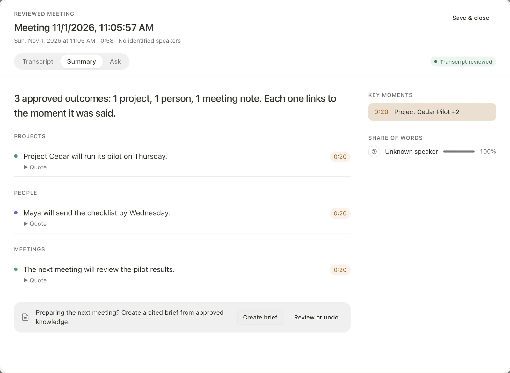

# Memoria

**Know what's decided. See what changed.**

Memoria is a meeting-memory app for Apple-silicon Macs. It transcribes meetings on the Mac, proposes the decisions and commitments it hears with their exact quotes, and keeps the approved ones in a ledger with their history.

[Published build `v0.3.1-uat`](https://github.com/sayyidsyamil/memoria/releases/tag/v0.3.1-uat) · [Local 0.3.2 candidate](docs/RELEASE_RECORD.md) · [Documentation](docs/README.md) · [Research](research/)



Native macOS interface, shown with a fictional review fixture.

## How it works

To answer "who is our vendor now?" or "what was the budget on 27 September?" from transcripts or summaries, an assistant has to re-read the meetings and work out the state again for every question. Memoria does that work once, when a meeting ends:

1. **Record.** Microphone audio, plus audio playing on the Mac when Call audio is on, is transcribed locally with speaker labels.
2. **Review.** A local model proposes each decision or commitment with its exact quote. You approve, correct or reject it.
3. **Recall.** Approved values go into a ledger with their history. Questions about now, a past date or the number of changes are answered by lookup, with the source quote or an explicitly labelled human-correction note.

During a meeting, Memoria can flag a sentence that contradicts an approved decision.

For example: Alpha Systems is approved; a later meeting proposes Beta Cloud. The
board keeps Alpha current until you accept the change, then shows Beta with Alpha
still in history and both source quotes accessible. The [demo and UAT tools](scripts/uat/README.md)
prepare this fictional workflow separately from participant tasks.

## Results

AMI corpus: 20 test meetings from five series, 96 questions, the same local model (Qwen3.5-4B) for the three model-based methods ([October evaluation](research/ledger-engine/results/ami/ami_test_report.md)). A [3 November audit](research/model-improvements/baseline-audit.md) adds the real engine with nothing extracted:

| | Memoria | Full transcripts in the prompt | Transcript search (BM25) | Empty record |
|---|---|---|---|---|
| All questions | 61% (59/96) | 43% (41/96) | 39% (37/96) | 60% (58/96) |
| Current value | 53% (18/34) | 71% (24/34) | 65% (22/34) | 0/34 |
| Value on a past date | 100% (29/29) | 21% (6/29) | 48% (14/29) | 29/29 |
| Number of changes | 36% (12/33) | 33% (11/33) | 3% (1/33) | 29/33 |
| Questions needing a value or real change | 18/38 | 26/38 | 23/38 | 0/38 |
| Nonzero change counts | 0/4 | 2/4 | 1/4 | 0/4 |
| Time per question | 3.0 s | 84.2 s | 3.4 s | — |

**The 61% aggregate is only one answer above recording nothing.** All 29 past-date answers are "none", and 29 change counts are zero. The ledger beats the text baselines on these empty answers but trails them on the 38 questions needing information. Against the empty record, 18 answers improve and 17 worsen (paired p = 1.0): no detected advantage on this reused split, not proof of equivalence.

- With gold facts the ledger answers 96/96; only 81/96 routes exactly match the intended lookup, with the other answers correct because they are empty. A simulated gold-aware reviewer raises accuracy to 85/96 (89%), including 31/38 questions needing information. This is an upper bound on review, not a user result.
- With a strong hosted model (DeepSeek V4.1 Flash, public AMI data only) the ledger scores 82/96, including 31/38 questions needing information. That model reading every transcript scores 81/96; the ledger uses 818 instead of 31,337 input tokens per question ([strong model](research/strong-model/README.md)). Asking the 4B model "is this really decided?" did no better than dropping the same number of proposals at random ([firmness gate](research/firmness-gate/README.md)).
- Replaying October's ledgers through the app's Ask gives 96/96 with gold facts and 58/96 with extracted facts, where the pipeline scored 59/96 ([app parity](research/app-parity/README.md)). These are routing regressions on reused data.
- Live contradiction check on the [MemoriaBench](research/memoriabench/) test split: 98/112 conflicts caught (87.5%), 2/224 false alarms (0.9%), 0.26 s per sentence (median). Spoken by six synthetic voices as 28 meetings and captioned live: the same 98/112. No alert on an hour of unrelated real speech. These follow-ups reuse the test partition ([method and limits](research/live-verifier/README.md)).
- In the installed app, two scripted meetings fed in real time: sentences committed 0.45–2.1 s after they ended, contradictions cued 0.46–1.15 s after the statement when its item was heard correctly, no false alarm ([live speech](research/live-speech/README.md)).
- Speech: Parakeet Ultra with Nemotron 3 Diarization transcribes a 60-minute AMI recording in 113 s, WER 14.4% (fillers removed), with 97.4% of labelled words on the right speaker. Live captions scored 15.2% WER in 0.3.0; the noisy-room pause fix in 0.3.1 scores 15.4%, with 97.6% speaker attribution ([live speech](research/live-speech/README.md)).

Why Qwen3.5-4B: [model bake-off](research/model-bakeoff/README.md).
The later [targeted 4B studies](research/REVIEW-2026-11-03.md) are complete; none qualified for deployment.

## Install (UAT build, Apple silicon, 16 GB)

The published [`v0.3.1-uat`](https://github.com/sayyidsyamil/memoria/releases/tag/v0.3.1-uat)
disk image is ad-hoc signed (right-click > Open the first time); its
[archived record](docs/releases/v0.3.1-uat.md) identifies that installer. A corrected
0.3.2 candidate is built and installed locally, with source/worker/browser checks
passed and native acceptance still pending; it is **not published**.

Call audio requires macOS 14.2+. Python runtimes and models are installed separately
with `scripts/install-shared-runtime.sh`. The doctor on current `main` expects 0.3.2;
use the doctor from `v0.3.1-uat` for the older published installer. See
[Install for another macOS account](docs/GETTING-STARTED.md#install-for-another-macos-account-ac7)
and the [current candidate record and remaining checks](docs/RELEASE_RECORD.md).

## Develop

Node.js 22.13+, pnpm 11.1.1 (pinned), Rust stable; Homebrew Python 3.11 for the local models.

```sh
git clone https://github.com/sayyidsyamil/memoria.git
cd memoria
pnpm install --frozen-lockfile
pnpm dev                     # browser build with a mock bridge
pnpm tauri dev               # native app; model setup in docs/DEVELOPMENT.md
```

To see Memoria's own screens in the browser build against a real vault: `MEMORIA_DEV_VAULT=<vault> VITE_MEMORIA_DEV_BRIDGE=1 pnpm exec vite`.

Checks for the 0.3.2 candidate (4 November): 6,821 frontend and 243 app Python tests
passed, with type checking, lint and locale validation. The 1,245 Rust tests passed
during preparation; Rust code was unchanged afterward. See
[verification](docs/WORKSPACE-PRODUCT-VERIFICATION.md) for scopes and skips.
The protected ledger engine's historical 291-test result is separate
([research](research/README.md)).

The candidate includes [number-word and digit-format fixes](research/number-word-fix/README.md),
clearer current/history controls and manual-correction provenance. These changes
postdate the published 0.3.1 installer.

React / TypeScript · Tauri / Rust · Python / MLX · Markdown / SQLite

## What is original

Memoria is an FYP2 project by [Sayyid Syamil](https://github.com/sayyidsyamil) (Universiti Malaya), built on [Tolaria](https://github.com/refactoringhq/tolaria) by Luca Rossi / Refactoring and contributors. The editor, vault, notes and app shell are Tolaria's work. Memoria adds the meeting pipeline, review, the ledger engine and its evaluation, Ask and briefs from tracked facts, the live check and MemoriaBench.

[AGPL-3.0-or-later](LICENSE) · [Third-party notices](NOTICE.md) · Design refinement follows [Unslop](https://github.com/heydamir/unslop) by Damir Sokolovsky, CC BY 4.0.

Branches: `main` is the current app. `fyp2` (tag `v0.1.0-uat`) is the build evaluated in October; `legacy` and `master` keep earlier work.
