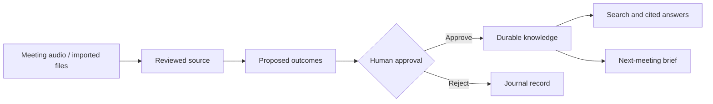

<div align="center">
  
  <h1>Memoria</h1>
  <p><strong>Meeting intelligence. Inspectable evidence. Durable memory.</strong></p>
  <p>A local-first desktop workspace that turns meetings into reviewed knowledge<br />and uses that knowledge to prepare the next conversation.</p>

  [](https://github.com/sayyidsyamil/memoria/actions/workflows/memoria-checks.yml)
  [](LICENSE)
  
  

  [Getting started](docs/DEVELOPMENT.md) · [Architecture](docs/ARCHITECTURE.md) · [Roadmap](docs/ROADMAP.md) · [Contributing](CONTRIBUTING.md)
</div>

---

## From conversation to context

Meeting notes are useful only if you can find them again, trust their sources, and
carry decisions forward. Memoria connects those steps in a file-based workspace:

**Capture → Review transcript → Approve outcomes → Search / Ask → Prepare a cited brief**

The language model proposes knowledge; **you decide what becomes durable**.
Approved statements retain their supporting quotes and source locations. Notes,
meeting records, and saved briefs remain portable Markdown.



## What you can do

| Surface | Purpose |
| --- | --- |
| **Record** | Capture microphone audio with a floating HUD, live draft captions, pause/resume, and marked moments. |
| **Transcript** | Review editable turns, correct provisional speaker names, and navigate the original audio. |
| **Summary** | Inspect approved decisions, commitments, projects, and topics with quotes and approximate timestamps. |
| **Search** | Find saved transcript lines and approved claims using transparent keyword/prefix matching. |
| **Ask** | Query approved knowledge and inspect the exact evidence behind citations. |
| **Briefs** | Prepare, save, and reopen a cited document for the next meeting. |

Files can also be imported as evidence. Proposed additions go through an explicit
review workflow, with a durable journal, stale-source checks, and conflict-aware undo.

## Design principles

- **Evidence before assertion.** Quotes and source links are inspectable; a matching
  quote establishes provenance, not truth or semantic correctness.
- **Human approval before publication.** Model suggestions do not directly rewrite
  your knowledge. Reviewed additions preserve existing text.
- **Files first.** Markdown carries durable knowledge; a vault-local SQLite journal
  records proposals and publication receipts.
- **Local meeting inference.** Speech, generation, and embedding workers run on the
  development machine using pre-cached models. This does not mean every inherited
  integration in the wider workspace is offline.
- **Honest interface state.** The waveform reflects microphone levels, the timer
  excludes pauses, and speaker statistics are labelled “share of words”.

See [UI patterns](docs/UI-PATTERNS.md) for the component and interaction rules.

## Project status

Memoria is an **FYP2 research prototype**, under active development. The meeting
runtime has been exercised on Apple Silicon macOS. The inherited desktop, web, and
mobile foundations do not establish cross-platform support for the new meeting AI.

There is no standalone, signed Memoria installer yet. Native inference currently
requires separately configured Python environments and cached model weights.
Transcription accuracy, long sessions, crash recovery, and final native acceptance
are still being evaluated. The recording-transcription path currently rejects
audio longer than ten minutes.

### Verification snapshot

| Check | Latest recorded result |
| --- | --- |
| Focused frontend suite | 66 tests passing across 14 files |
| Python engine/product suite | 30 tests passing |
| TypeScript and scoped lint | Passing |
| Native debug bundle | Built locally |
| Full frontend suite | 6,326 passing, 97 failing, 1 skipped; outstanding rebrand/integration cases |

These are the 1 November 2026 development results, not live coverage metrics or a
claim of release readiness. The CI badge covers the scoped Memoria checks only.
Detailed observations and outstanding native checks are in
[Workspace product verification](docs/WORKSPACE-PRODUCT-VERIFICATION.md).

## Get started

Use **Node.js 22+, pnpm 10, and Rust stable**. Native development also needs the
[Tauri platform prerequisites](https://v2.tauri.app/start/prerequisites/).

```sh
git clone https://github.com/sayyidsyamil/memoria.git
cd memoria
pnpm install --frozen-lockfile
pnpm dev
```

The browser development view uses a mock bridge; it is useful for UI work but does
not exercise native recording or the local model workers.

For the desktop app, configure the runtime paths described in
[Development setup](docs/DEVELOPMENT.md), then run:

```sh
pnpm tauri dev
```

### Checks

```sh
pnpm build
pnpm test:memoria
python3 -m unittest discover -s src-tauri/resources/memory -p 'test_workspace_product.py'
python3 -m unittest discover -s src-tauri/resources/memory -p 'test_engine.py'
```

## Repository map

| Path | Contents |
| --- | --- |
| `src/` | React/TypeScript workspace and meeting interfaces |
| `src-tauri/src/` | Rust commands, capture integration, and model lifecycle |
| `src-tauri/resources/memory/` | Local speech, retrieval, proposal journal, and generation adapters |
| `memoria-demo/` | Fictional Markdown meeting scenario; copy before experimenting |
| `docs/` | Architecture, setup, design decisions, and verification records |
| `apps/`, `packages/`, `site/` | Inherited and rebranded workspace foundations |
| `reference/upstream-workflows/` | Archived upstream CI/release definitions, not active Memoria automation |

## Roadmap

1. Complete native acceptance of recording, marks, saved review, and cited briefs.
2. Make model setup reproducible and package the inference runtime.
3. Evaluate speaker/ASR quality, retrieval, and evidence-grounded answers.
4. Improve recovery, long-session handling, and model memory management.
5. Reconcile outstanding full-suite failures before a supported release.

See the [roadmap](docs/ROADMAP.md) for acceptance criteria.

## Contributing and security

Issues and focused pull requests are welcome. Please read
[CONTRIBUTING.md](CONTRIBUTING.md), use fictional fixtures, and include relevant
verification. Report vulnerabilities privately through the process in
[SECURITY.md](SECURITY.md).

## Attribution and license

Memoria is developed by [Sayyid Syamil](https://github.com/sayyidsyamil) as an FYP2
project, **derived from [Tolaria](https://github.com/refactoringhq/tolaria)** by Luca
Rossi / Refactoring and contributors. Tolaria provides the inherited Markdown
workspace; Memoria adds the meeting-oriented capture, reviewed memory, and briefing
workflow. Inherited capabilities are not claimed as original Memoria contributions.

The project retains **AGPL-3.0-or-later** licensing, upstream history, and third-party
notices. See [LICENSE](LICENSE) and [NOTICE.md](NOTICE.md). Model weights have their
own terms and are not included. Memoria is not an official Tolaria release and is
not affiliated with upstream sponsorships or hosted services.

### Earlier versions

`main` contains the desktop workspace. `legacy` preserves the previous Next.js
default branch; the existing `fyp2` and `master` branches retain their earlier work.
