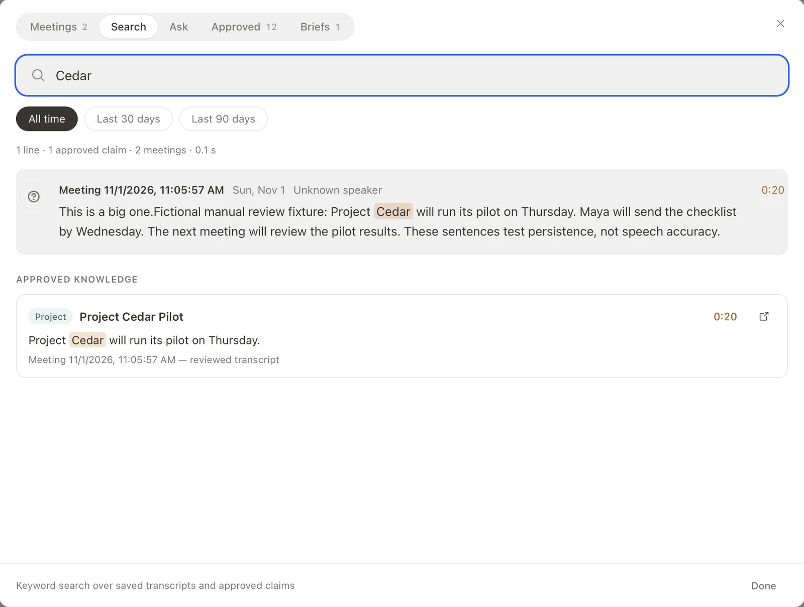

# Memoria

Reviewed meeting knowledge, with the evidence attached

Memoria records a meeting, lets you review its transcript, and turns approved
outcomes into knowledge you can search and use in the next meeting.

[Developer setup](docs/DEVELOPMENT.md) · [Roadmap](docs/ROADMAP.md)


Native macOS interface, shown with a fictional Cedar review fixture

## Meeting workflow

1. **Capture** microphone audio, pause when needed, and mark moments.
2. **Review** the draft transcript and provisional speaker labels.
3. **Approve** proposed outcomes with their supporting quotes.
4. **Reuse** approved knowledge through Search, Ask, or a saved meeting brief.

The model proposes additions; human approval makes them durable. Meeting records,
knowledge, and briefs remain Markdown files. The vault-local journal records
publication and supports conflict-aware undo.

## Find the source

Keyword search returns transcript matches and approved claims. Timestamp links
lead back to the recording; quote disclosures make the evidence inspectable.



[Transcript view](docs/media/transcript.webp) · [Ask view](docs/media/ask.webp) · [Saved brief](docs/media/brief.webp)

## Development

Requires Node.js 22+, pnpm 10, and Rust stable for the native app.

```sh
git clone https://github.com/sayyidsyamil/memoria.git
cd memoria
pnpm install --frozen-lockfile
pnpm dev
```

Browser mode uses a mock bridge. For microphone capture and local models, follow
[native runtime setup](docs/DEVELOPMENT.md), then run `pnpm tauri dev`.

React / TypeScript · Tauri / Rust · Python / MLX · Markdown / SQLite

## Current status

FYP2 research prototype, evaluated on Apple Silicon macOS. Model environments and
cached weights require separate setup; there is no supported standalone installer
yet. Speech quality, long-session recovery, and native acceptance remain in progress.

The focused suites pass 69 frontend and 30 engine/product tests. The broader suite
has 97 outstanding failures. See [verification](docs/WORKSPACE-PRODUCT-VERIFICATION.md)
for results and limitations. Quote matching proves provenance, not factual truth;
local meeting inference does not make every inherited integration offline.

## Project documentation

- [Architecture](docs/ARCHITECTURE.md) and [model lifecycle](docs/MODEL-LIFECYCLE.md)
- [Research evidence](research/) behind the FYP evaluation: ledger engine and MemoriaBench
- [UI conventions](docs/UI-PATTERNS.md) and [Unslop audit](docs/UNSLOP-PASS.md)
- [Fictional demo vault](memoria-demo/)
- [Contributing](CONTRIBUTING.md), [issues](https://github.com/sayyidsyamil/memoria/issues), and [security](SECURITY.md)

## Attribution

Developed by [Sayyid Syamil](https://github.com/sayyidsyamil) for FYP2, derived from
[Tolaria](https://github.com/refactoringhq/tolaria) by Luca Rossi / Refactoring and
contributors. The inherited Markdown workspace remains attributed upstream;
Memoria adds the meeting-oriented workflow.

[AGPL-3.0-or-later](LICENSE) · [Third-party notices](NOTICE.md)

Design refinement follows [Unslop](https://github.com/heydamir/unslop) by Damir
Sokolovsky ([@heydamir](https://x.com/heydamir)), CC BY 4.0.

`main` is the desktop workspace. `legacy` preserves the previous Next.js default;
`fyp2` (tag `v0.1.0-uat`, the app evaluated in the FYP2 report) and `master` retain earlier work.
