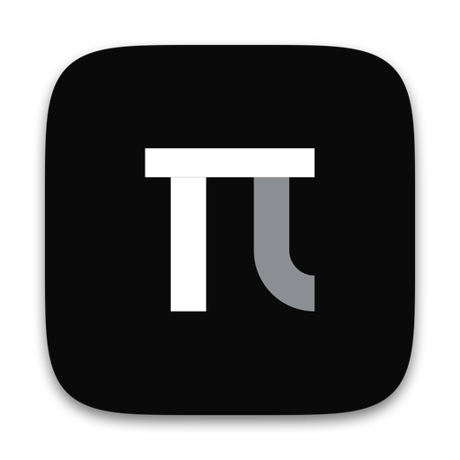
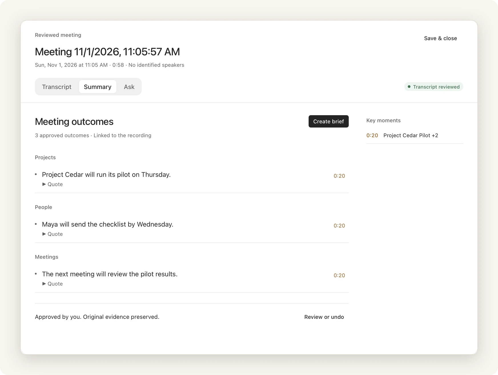
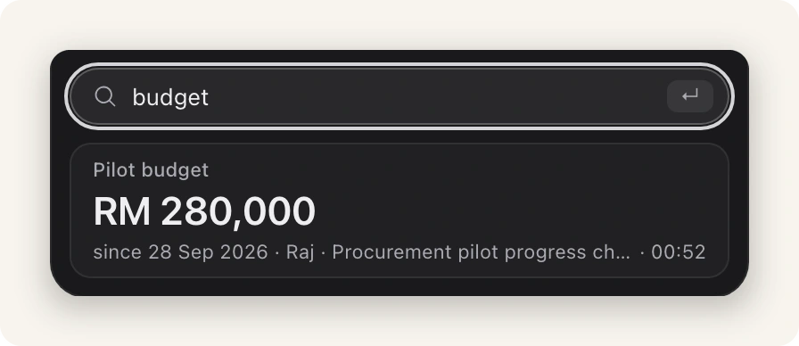

<p align="center">
  <picture>
    <source media="(prefers-color-scheme: dark)" srcset="src-tauri/icons/512x512-dark.png">
    <source media="(prefers-color-scheme: light)" srcset="src-tauri/icons/512x512.png">
    
  </picture>
</p>

<h1 align="center">Memoria</h1>

<p align="center"><strong>Version control for decisions.</strong></p>

<p align="center">AI notetakers capture what was said. Memoria keeps what was decided.</p>

<p align="center">
  <a href="LICENSE"></a>
  <a href="#install"></a>
  <a href="https://github.com/sayyidsyamil/memoria/releases/tag/v0.3.1-uat"></a>
  <a href="https://sayyidsyamil.github.io/memoria/"></a>
</p>

<p align="center">
  
  <br>
  <sub>Real app · fictional data</sub>
</p>

## Propose. Approve. Remember.

Meetings make decisions. Then the decisions drift. Memoria keeps them as a record, on your Mac.

1. **Propose.** After a meeting, a local model proposes each decision with its source quote. Code locates the source text and stores the quotation copied from it.
2. **Approve.** A person approves first values and changes. Unchanged confirmations may record automatically.
3. **Remember.** The record keeps earlier values with their sources.

**One known gap:** confirming today's value can cancel an approved future change or swap the cited quote. Review found it; the staged fix checks the whole timeline and the sources first. It is staged, not built. [Full account](https://sayyidsyamil.github.io/memoria/#known-defect).

> Language models are good at reading and bad at keeping state. Ledgers are good at state. So the model proposes, a person approves, and the ledger remembers.

## Ask what the record said on any date.

Tracked values are looked up in the ledger, not generated by the model.

| Ask | Memoria answers with |
|---|---|
| What is the vendor now? | The current approved value |
| What was the budget on 27 September? | The value that applied on that date |
| What did the record say on 1 October? | The value as recorded by that date |
| How many times did the go-live date change? | The number of approved changes |

Answers show their source: approved values cite their meeting quote, and a manual correction shows who corrected it and why. Other questions are drafted from approved passages, with checked citations. During a meeting, a live check flags a statement that goes against an approved decision.

## Forgot something? Just ask.

`In development` `0.3.6, not released`

Quick Ask is an always-visible search pill in the meeting window (⌘K). As you type, it shows the latest approved answer with its source, from the record and with no model call. Press Enter to ask a full grounded question.

<p align="center">
  
  <br>
  <sub>Real app · fictional data · text-fed demo · 0.3.6, not installed</sub>
</p>

## Runs on your Mac.

Speech recognition, the language model and search run on the Mac. Model weights download once, at setup.

**Memoria's 14 processes sent 0 bytes.** `One measured run` of about 2 minutes on installed 0.3.4, a later local build, covering a live meeting and two questions. Control: 15 other processes on the Mac moved data in the same 2 minutes.

Optional workspace features, such as Git sync, can use the network.

<details>
<summary>The models</summary>
<br>

| Model | Role | License |
|---|---|---|
| [Qwen3.5-4B](https://huggingface.co/Qwen/Qwen3.5-4B), MLX 4-bit | Proposals, the live check and Ask | Apache-2.0 |
| [Parakeet Ultra](https://huggingface.co/moondream/parakeet-ultra), from [NVIDIA Parakeet TDT 0.6B v3](https://huggingface.co/nvidia/parakeet-tdt-0.6b-v3), MLX | Captions and transcripts | CC BY 4.0 |
| [Nemotron 3 Diarization](https://huggingface.co/nvidia/Nemotron-3-Diarization), MLX | Who spoke when | OpenMDW 1.1 |
| [EmbeddingGemma 2](https://huggingface.co/google/embeddinggemma-2), MLX 5-bit | Search | Apache-2.0 |
| [Resemblyzer](https://github.com/resemble-ai/Resemblyzer) 0.1.4 | Remembered voices, opt-in | Apache-2.0 |

Weights are not part of this repository.

</details>

## Results

Small and scoped. The full evaluation is in [research](research/README.md).

**Local model, October 2026** `Historical, manual AMI` `No review`

| | Record | Full transcripts | Transcript search (BM25) | Empty record |
|---|---|---|---|---|
| Correct answers, of 96 | 59 | 41 | 37 | 58 |
| Correct answers, of the 38 that need a recorded value or a nonzero change count | 18 | 26 | 23 | 0 |
| Median model-call time per question | 2.94 s | 84.2 s | 3.4 s | |

**Hosted model, 2 November 2026** `Hosted model, public data`

| | Record | Full transcripts |
|---|---|---|
| Correct answers, of 96 | 82 | 81 |
| Mean input tokens per question | 818 | 31,337 |

- **An empty record scores 58.** Of the 96 gold answers, 29 are "none" and 29 are a zero count. No paired difference was detected between the record and the empty record (18 vs 17, p = 1.0). On the 38 questions that need a recorded value or a nonzero change count, the local record is behind both text baselines.
- **The hosted run shows no paired difference** between the record and full transcripts (10 vs 9, p = 1.0). It changed the extractor and the router together. Token counts leave out extraction; counting it, the record used 3,616 input tokens per question.
- **Extraction is the bottleneck.** The local model matched 31 of 46 gold decision events.
- **Times are model calls only**, not speech, review or app latency. Extraction ran once per meeting before any question: 63.2 s per meeting (mean).
- **Not measured yet:** human review and user testing.

Conditions: 20 public [AMI](https://groups.inf.ed.ac.uk/ami/corpus/) test meetings, 96 questions, manual transcripts and an unreviewed record. Local runs used Qwen3.5-4B on an Apple M5 Mac with 16 GB. The hosted run used DeepSeek V4.1 Flash as extractor and router, one run. These are historical research runs, not an end-to-end test of this build.

## Install

Download [`Memoria_0.3.1_aarch64.dmg`](https://github.com/sayyidsyamil/memoria/releases/tag/v0.3.1-uat), a pre-release for user testing.

- Built and tested on an Apple silicon Mac with 16 GB of memory. Call audio needs macOS 14.2 or later.
- The models and Python runtimes install separately with `scripts/install-shared-runtime.sh`. Use the setup scripts from the `v0.3.1-uat` tag with this installer. Steps: [Getting started](https://github.com/sayyidsyamil/memoria/blob/v0.3.1-uat/docs/GETTING-STARTED.md#install-for-another-macos-account-ac7).
- The app is ad-hoc signed and not notarised, so macOS asks you to confirm the first open.

`main` holds the 0.3.2 source, which is not published as a build. In development, not released: the whole board on a date, a cue when a replaced decision comes back, and Quick Ask. The [project page](https://sayyidsyamil.github.io/memoria/) shows them with their build status.

## Build from source

```sh
git clone https://github.com/sayyidsyamil/memoria.git
cd memoria
pnpm install --frozen-lockfile
pnpm dev          # browser build with a mock bridge
pnpm tauri dev    # native app
```

Node.js 22.13 or later, pnpm 11.1.1 and Rust stable; the native app also needs the Xcode Command Line Tools, and the local models need Homebrew Python 3.11. Model runtimes and model-free tests: [Development setup](docs/DEVELOPMENT.md).

React and TypeScript · Tauri and Rust · Python and MLX · Markdown and SQLite

## Documentation

- [Documentation](docs/README.md): architecture, the decision ledger, meetings and the model workers.
- [Research](research/README.md): every evaluation, with its scripts and results.
- [Verification](docs/WORKSPACE-PRODUCT-VERIFICATION.md): test runs and native checks, newest first.
- [Project page](https://sayyidsyamil.github.io/memoria/): the film, the two-dates demo and the methods.

## License

Open source under [AGPL-3.0](LICENSE). Third-party notices: [NOTICE.md](NOTICE.md).

## Citation

```bibtex
@misc{syamil2026memoria,
  author = {{Sayyid Syamil Syed Mohamed}},
  title = {Memoria: Version Control for Decisions},
  year = {2026},
  howpublished = {\url{https://sayyidsyamil.github.io/memoria/}},
  note = {Final-year project, Universiti Malaya. 5 November 2026}
}
```

<br>

<p align="center"><strong>Keep decisions checkable.</strong></p>

<p align="center"><sub>Sayyid Syamil · Universiti Malaya</sub></p>
