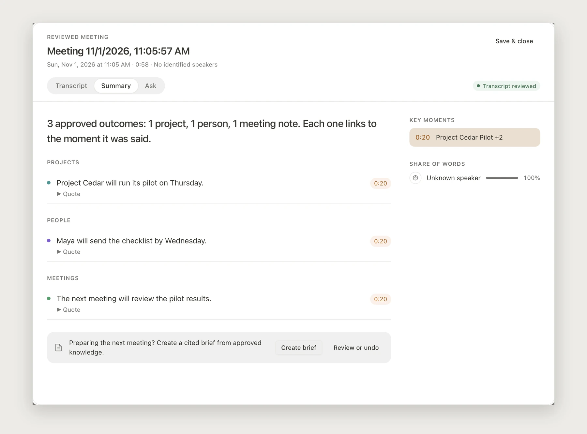
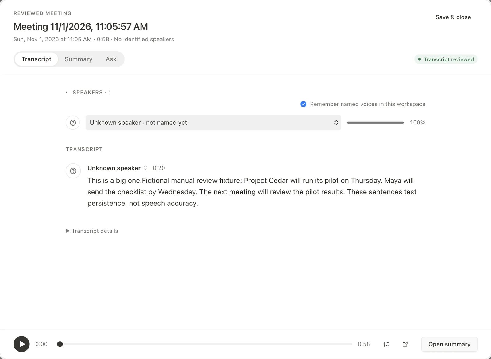
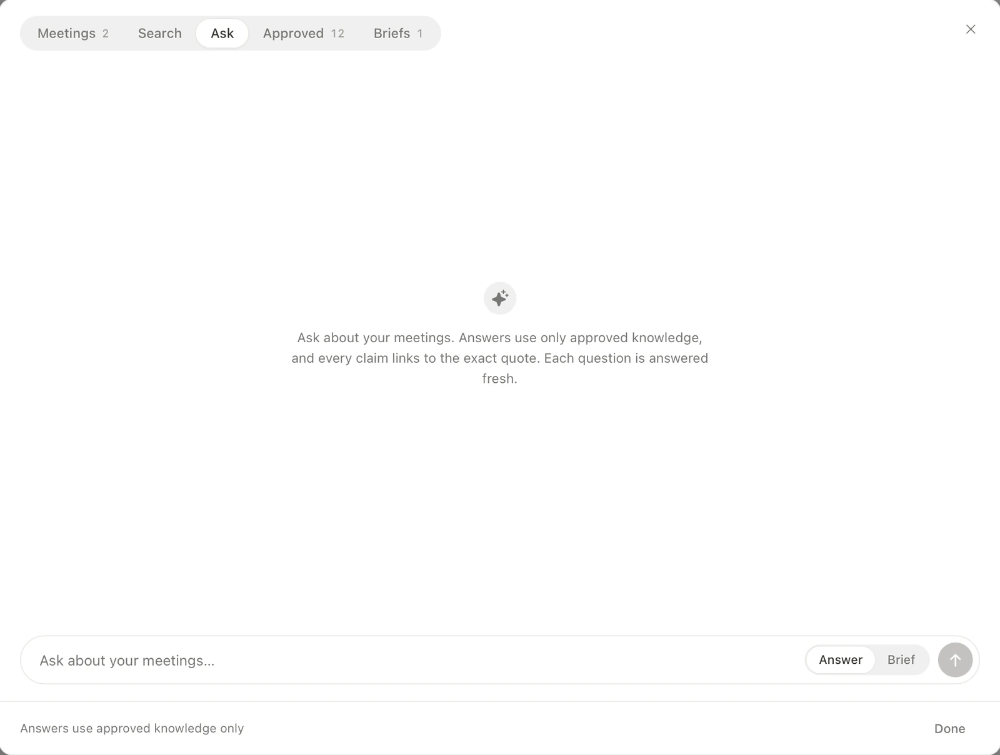
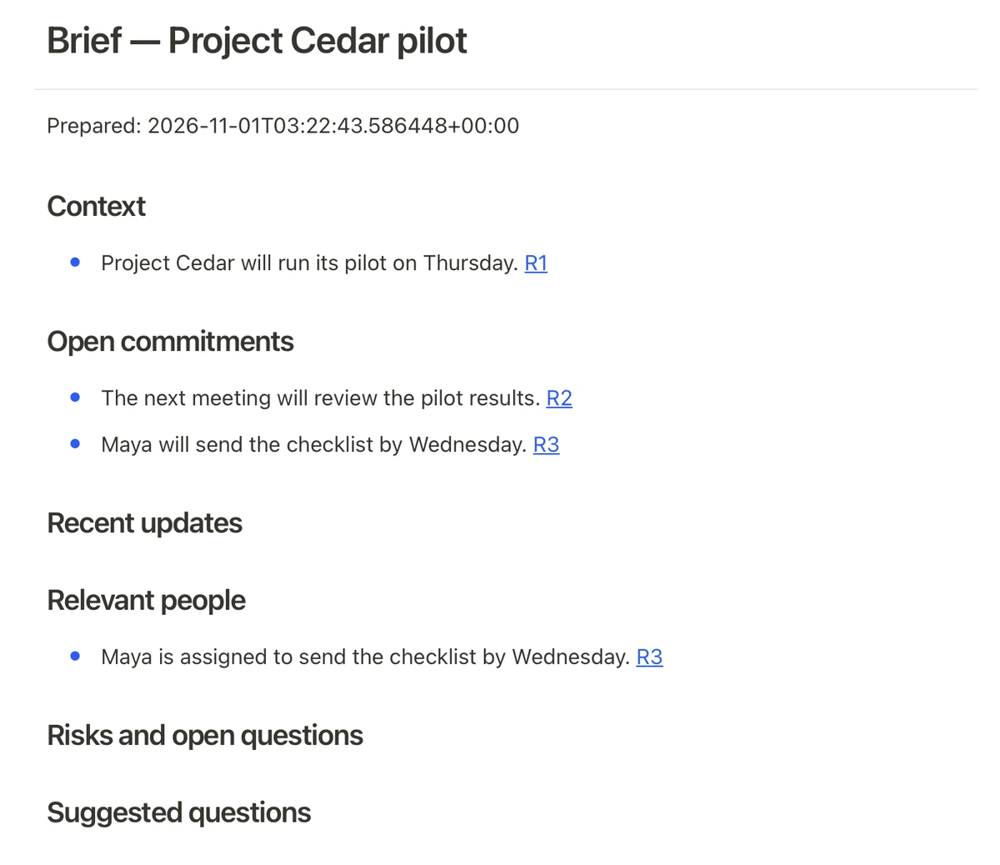

<div align="center">
  
  <h1>Memoria</h1>
  <p><strong>Turn meetings into knowledge you can use again.</strong></p>
  <p>A local-first workspace for reviewed transcripts, evidence-linked outcomes,<br />and a better-prepared next meeting.</p>
  <p>
    <a href="LICENSE"></a>
    
    
  </p>
  <p>
    <a href="#a-closer-look">Product tour</a> ·
    <a href="docs/DEVELOPMENT.md">Developer setup</a> ·
    <a href="docs/ROADMAP.md">Roadmap</a> ·
    <a href="https://github.com/sayyidsyamil/memoria/discussions">Discussions</a>
  </p>
</div>

<p align="center">
  <a href="docs/media/hero.webp"></a>
  <br /><sub>Native macOS interface · fictional Cedar review fixture · not an ASR-accuracy demonstration</sub>
</p>

## One meeting. Useful memory.

**Capture → Review → Approve → Ask → Prepare**

Memoria connects the conversation to what comes next. Review the transcript,
approve what matters, and return to the original evidence whenever you need it.

<table>
  <tr>
    <td width="33%"><strong>You decide what lasts.</strong><br />AI proposes outcomes. Human approval makes them durable.</td>
    <td width="33%"><strong>Evidence stays close.</strong><br />Inspect quotes and follow approximate timestamps back to the recording.</td>
    <td width="33%"><strong>Your files stay yours.</strong><br />Meeting records, knowledge, and saved briefs are portable Markdown.</td>
  </tr>
</table>

## A closer look

<table>
  <tr>
    <td width="50%">
      <h3>01 / Review the conversation</h3>
      <p>Editable transcript turns, provisional speaker labels, and an always-available recording player.</p>
      <a href="docs/media/transcript.webp"></a>
    </td>
    <td width="50%">
      <h3>02 / Find the original moment</h3>
      <p>Keyword search brings together transcript matches and approved knowledge, with source-time links.</p>
      <a href="docs/media/search.webp"></a>
    </td>
  </tr>
  <tr>
    <td width="50%">
      <h3>03 / Ask your approved knowledge</h3>
      <p>A focused Answer / Brief composer. Answers are grounded in approved claims and inspectable quotes.</p>
      <a href="docs/media/ask.webp"></a>
    </td>
    <td width="50%">
      <h3>04 / Prepare the next meeting</h3>
      <p>Reopen a saved brief with context, open commitments, relevant people, and evidence references.</p>
      <a href="docs/media/brief.webp"></a>
    </td>
  </tr>
</table>

<p align="center"><sub>Captured with agent-desktop from the native debug app. Images are cropped and resized; UI content is unchanged. <a href="docs/media/README.md">Image provenance</a></sub></p>

### Built around the work

- **Floating recording HUD** — live draft captions, pause/resume, and marked moments.
- **Reviewed outcomes** — approve proposed knowledge with exact supporting quotes.
- **Meeting memory** — one hub for Meetings, Search, Ask, Approved, and Briefs.
- **Local inference** — speech, generation, and retrieval use development-machine workers and cached models.

<p><strong>Under the hood:</strong> React + TypeScript · Tauri + Rust · Python + MLX · Markdown + SQLite</p>

## Try the workspace

Requires **Node.js 22+, pnpm 10, and Rust stable** for native development.

```sh
git clone https://github.com/sayyidsyamil/memoria.git
cd memoria
pnpm install --frozen-lockfile
pnpm dev
```

Browser mode uses a mock bridge. For real recording and local models, follow
[native runtime setup](docs/DEVELOPMENT.md), then run `pnpm tauri dev`.

## Currently in development

**FYP2 research prototype.** Evaluated on Apple Silicon macOS; standalone model
setup, signed installers, long-session recovery, and speech quality remain in progress.
Local meeting inference does not make every inherited integration offline.
Exact quote matching establishes provenance, not factual truth.

<details>
  <summary><strong>Verification and current limitations</strong></summary>

  <p>Recorded development checks: <strong>66 focused frontend tests</strong> and <strong>30 Python engine/product tests</strong> pass; TypeScript, scoped lint, and native debug builds pass.</p>
  <p>The full frontend suite still has 97 failures (6,326 passing, 1 skipped). The scoped checks do not establish full regression stability or release readiness. The recording-transcription path currently rejects audio longer than ten minutes.</p>
  <p>See <a href="docs/WORKSPACE-PRODUCT-VERIFICATION.md">verification evidence</a> and <a href="docs/ROADMAP.md">acceptance roadmap</a> for the remaining native checks and evaluation work.</p>
</details>

## Explore the project

| Build | Understand | Contribute |
| :--- | :--- | :--- |
| [Development setup](docs/DEVELOPMENT.md) | [Architecture](docs/ARCHITECTURE.md) | [Contribution guide](CONTRIBUTING.md) |
| [Fictional demo vault](memoria-demo/) | [UI / UX patterns](docs/UI-PATTERNS.md) | [Issues](https://github.com/sayyidsyamil/memoria/issues) |
| [Scoped CI definition](.github/workflows/memoria-checks.yml) | [Model lifecycle](docs/MODEL-LIFECYCLE.md) | [Security reporting](SECURITY.md) |

---

<p align="center">
  Built by <a href="https://github.com/sayyidsyamil">Sayyid Syamil</a> for FYP2.<br />
  Derived from <a href="https://github.com/refactoringhq/tolaria">Tolaria</a> by Luca Rossi / Refactoring and contributors.<br />
  <sub>The inherited Markdown workspace remains attributed upstream. Memoria adds the meeting-oriented workflow.<br />AGPL-3.0-or-later · <a href="NOTICE.md">Attribution and third-party notices</a> · Model weights are not included.</sub>
</p>

<p align="center"><sub><code>main</code> — desktop workspace · <code>legacy</code> — previous Next.js default · <code>fyp2</code> / <code>master</code> — earlier work</sub></p>
